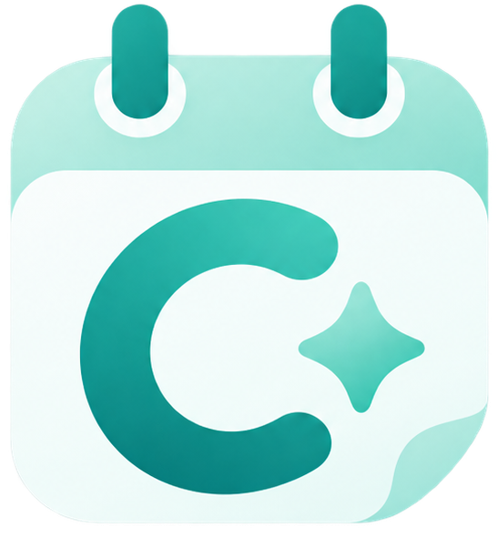
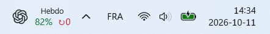
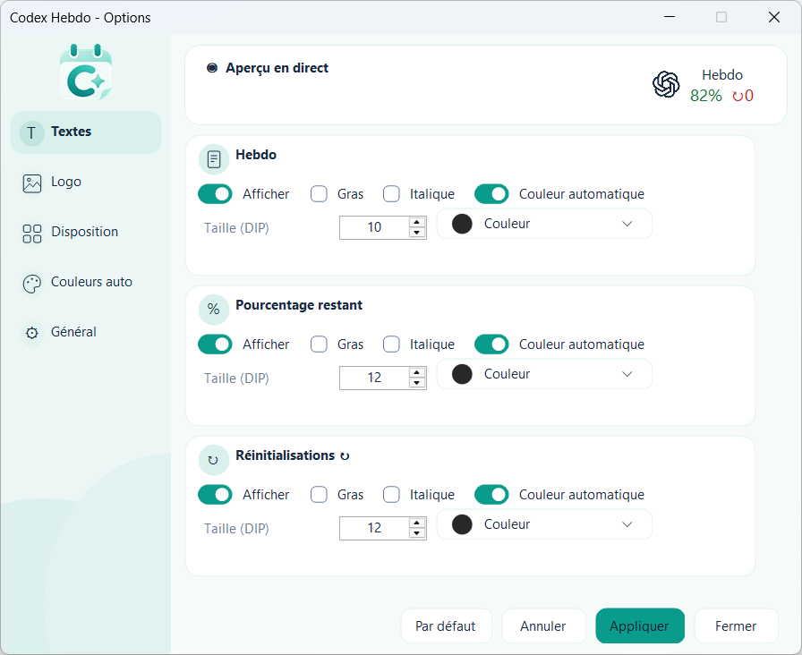
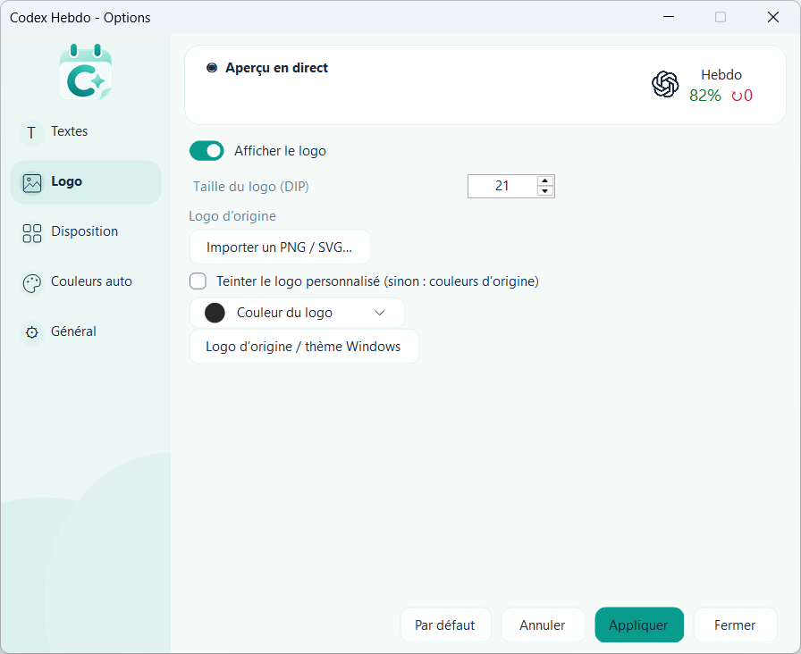
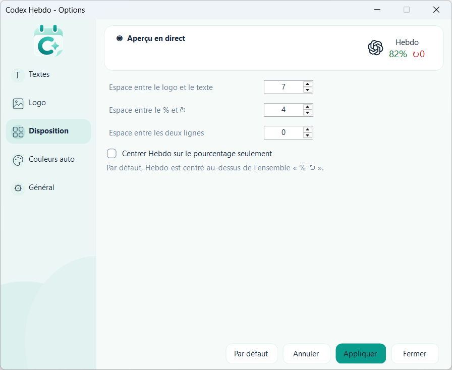
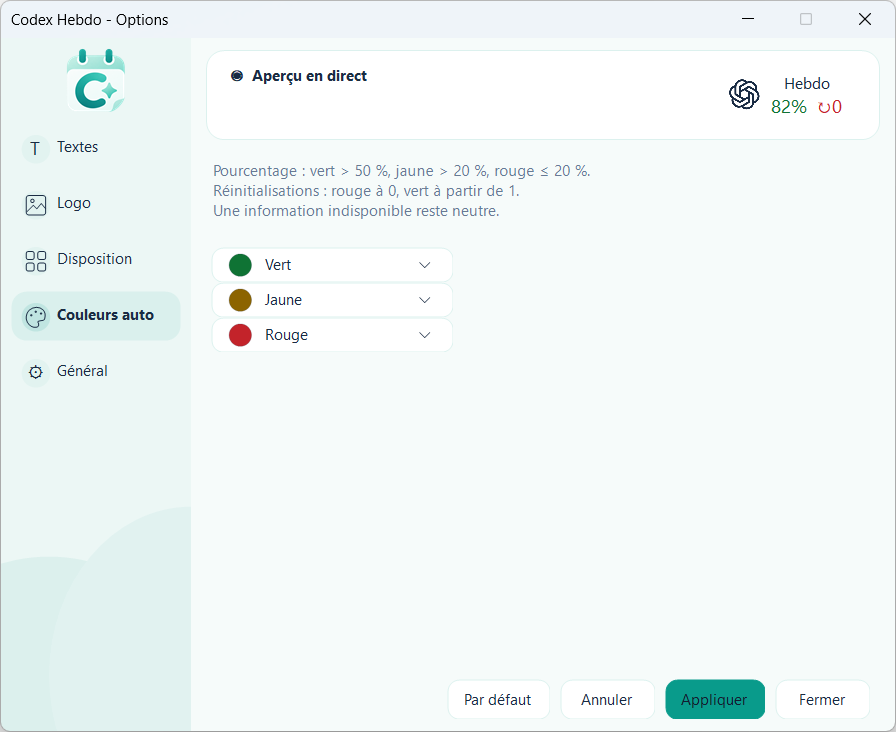

<div align="center">
  
  <h1>Codex Hebdo</h1>
  <p><strong>Votre quota Codex, toujours à portée de regard.</strong></p>
  <p>Un widget discret dans la barre des tâches de Windows 11.<br>Le pourcentage restant, les réinitialisations disponibles et juste ce qu’il vous faut.</p>
  <p>
    
    
    
  </p>
  <p><a href="#aperçu">Aperçu</a> · <a href="#personnalisation">Personnalisation</a> · <a href="#installation">Installation</a> · <a href="#english">English</a></p>
  <br>
  
  <p><sub>Une vraie place dans la barre des tâches, à côté de vos icônes habituelles.</sub></p>
</div>

## Aperçu

**Gardez un œil sur votre semaine Codex sans interrompre votre travail.** Codex Hebdo affiche votre quota hebdomadaire restant directement dans la barre des tâches. Un double-clic ouvre les réglages et leur aperçu en direct.

<p align="center">
  
</p>

| L’essentiel | En pratique |
| :--- | :--- |
| **Quota hebdomadaire** | Le pourcentage restant, actualisé automatiquement. |
| **Réinitialisations disponibles** | Un compteur compact : `↻0`, `↻1`, etc. |
| **Intégration native** | Le widget occupe sa propre place dans la barre des tâches Windows. |
| **Options au double-clic** | Les clics simples et droits ne déclenchent aucun menu. |
| **Français et anglais** | Interface, widget, infobulles et détails du quota. |
| **Démarrage avec Windows** | Activable depuis les réglages. |

Les chiffres des captures sont des exemples issus de l’application ; votre widget affiche les données de votre compte.

## Personnalisation

### Petit widget, grands choix

Ajustez indépendamment **Hebdo**, le **pourcentage** et les **réinitialisations** : visibilité, taille, gras, italique et couleur. Modifiez les espacements et choisissez le centrage qui vous convient.

Les changements apparaissent en direct. **Appliquer** enregistre vos choix ; **Annuler** ou **Fermer** restaure les derniers réglages enregistrés.

<table>
  <tr>
    <td width="50%"><strong>Votre logo</strong><br>Importez un PNG ou un SVG, ajustez sa taille et choisissez sa teinte.</td>
    <td width="50%"><strong>Votre disposition</strong><br>Réglez les espacements et l’alignement du titre au-dessus des chiffres.</td>
  </tr>
  <tr>
    <td></td>
    <td></td>
  </tr>
</table>

### Une interface à vos couleurs

Choisissez parmi **Référence · Glacier · Lavande · Rosé · Sable · Minuit**, puis ajustez la couleur d’accent à votre goût. Les thèmes de la fenêtre et les couleurs du widget se règlent séparément.

<details>
<summary><strong>Voir les couleurs automatiques du widget</strong></summary>

<p align="center">
  
</p>

| Indicateur | Couleurs par défaut |
| :--- | :--- |
| Quota restant | Vert au-dessus de 50 %, jaune au-dessus de 20 %, rouge à 20 % ou moins. |
| Réinitialisations | Rouge à zéro, vert dès qu’une réinitialisation est disponible. |
| Données indisponibles | Affichage neutre `--` ou `↻--`. |

Ces couleurs sont personnalisables. Le compteur de réinitialisations est informatif : **l’application ne consomme aucune réinitialisation**.

</details>

## Installation

> **Distribution actuelle : sources et scripts.** L’installateur unique incluant toutes les dépendances n’est pas encore disponible.

### Prérequis

- **Windows 11 x64**.
- **Codex installé et connecté** à votre compte.
- **Windhawk**, avec son compilateur, installé depuis [windhawk.net](https://windhawk.net/).
- **SDK .NET 10** pour compiler, et **runtime .NET Desktop 10 x64** pour exécuter l’application.

### Compiler et installer

Clonez le dépôt, puis ouvrez PowerShell dans son dossier :

```powershell
git clone https://github.com/HuRRR-ops/Codex-Hebdo.git
cd Codex-Hebdo
```

Indiquez le dossier de votre installation Windhawk :

```powershell
.\Build.ps1 -WindhawkPath "C:\chemin\vers\Windhawk"
.\Install.ps1 -WindhawkPath "C:\chemin\vers\Windhawk"
```

Avec **Windhawk portable**, le script configure le mod automatiquement. Avec une installation **standard**, suivez les instructions affichées pour importer et compiler le mod dans Windhawk.

Une fois installé, **double-cliquez sur le widget** pour ouvrir les options. Vos préférences sont conservées lors des mises à jour.

Pour les chemins d’installation, les symboles Windows et la désinstallation, consultez le [guide technique](docs/TECHNICAL.md).

## Des données utiles, des réglages locaux

- Seul le **quota hebdomadaire Codex** est affiché.
- Le compagnon reçoit les notifications de `codex app-server` et interroge les limites toutes les **30 secondes**.
- Une mesure vieille de plus de **75 secondes** n’est plus présentée comme actuelle.
- Les préférences et les logos importés restent **sur votre ordinateur**.
- Le code ne lit pas les fichiers d’authentification et ne conserve pas les messages bruts du serveur.

## Développement

Le projet associe un compagnon **C# / .NET** à un mod **C++ / Windhawk**. La suite compte **141 tests automatisés**, complétés par des vérifications de compilation, d’IPC et d’intégration dans Explorer.

[Guide technique](docs/TECHNICAL.md) · [Validation](TESTS.md) · [Composants tiers](THIRD-PARTY-NOTICES.txt) · [Signaler un problème](https://github.com/HuRRR-ops/Codex-Hebdo/issues)

L’intégration cible la barre horizontale principale de Windows 11 et dépend de structures internes de Windows. Les changements de DPI, de résolution et les configurations de barre des tâches nécessitent encore une validation plus large.

## English

**Your weekly Codex quota, right in the Windows 11 taskbar.** See your remaining percentage and available reset credits at a glance. Double-click the widget to customize text, import a logo, adjust spacing or choose one of six interface themes.

Select **Général → Langue / Language → English** to switch the interface, widget and tooltips to English. Changes preview live; **Apply** saves them and **Cancel / Close** restores your saved settings.

Windows 11 x64, a signed-in Codex installation, Windhawk and .NET 10 are required. This repository currently ships **source code and build/install scripts**; an all-in-one installer is not available yet. The reset counter is informational and never spends reset credits.
